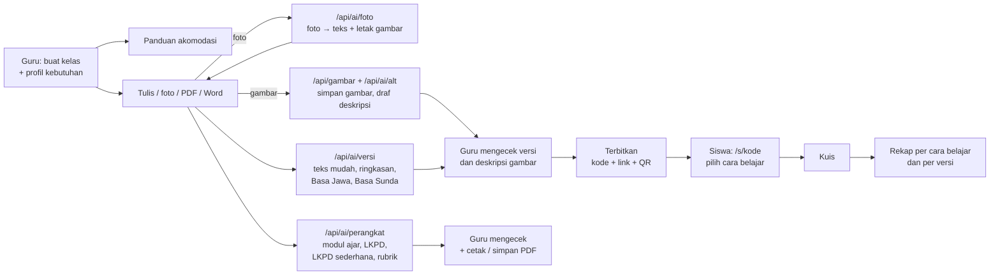

# Selaras

**Guru menyiapkan sekali, setiap siswa bisa mengikuti.**

Selaras adalah platform web pembelajaran inklusif. Guru cukup menulis, memotret, atau mengunggah materi (PDF/Word) satu kali. Selaras lalu menyiapkannya dalam beberapa versi yang bisa dipilih siswa sesuai cara belajarnya: teks mudah, ringkasan, Basa Jawa, Basa Sunda (dengan glosarium dua bahasa), huruf besar, kontras tinggi, spasi lega, garis bantu baca, atau dibacakan. Gambar dan diagram dari buku ikut tampil, lengkap dengan deskripsi gambar (alt text) untuk siswa tunanetra dan low vision.

Dibuat untuk **Hackathon JOINTS UGM 2026** (JOINTSxINSPIRE, HIMAKOM FMIPA UGM), tema **Education**.

| | |
|---|---|
| 🌐 Aplikasi | _isi link Vercel_ |
| 🎬 Video demo | _isi link YouTube_ |
| 📊 Pitch deck | _isi link PDF_ |
| 👩‍🏫 Akun demo guru | `guru@selaras.id` / `selaras-demo` (atau tombol **Masuk sebagai guru demo**) |
| 📱 Materi demo untuk siswa | `/s/DEMO01` (Fotosintesis), `/s/DEMO02` (Bagian Tumbuhan), `/s/DEMO03` (Teks Prosedur) |

---

## Masalah

Guru honorer dan guru kelas gabungan sudah kehabisan waktu untuk modul ajar, soal, dan rapor. Mereka tidak sempat membuat versi materi yang berbeda untuk siswa low vision, tuli, disleksia, sulit fokus, atau siswa yang bahasa ibunya bukan bahasa Indonesia. Akibatnya, siswa-siswa ini tertinggal di kelas yang sama.

## Solusi

Selaras membuat inklusi tidak menambah beban guru.

- **Sisi guru:** guru mengisi profil kebutuhan kelas (hanya jumlah siswa per kebutuhan, tanpa nama), lalu mendapat panduan akomodasi yang bisa dicentang. Guru menulis atau memotret materi sekali, AI menyiapkan draf versinya, dan guru mengecek setiap versi sebelum terbit.
- **Sisi siswa:** siswa membuka materi lewat link atau QR tanpa login, memilih "cara belajarku", membaca atau mendengarkan materi, lalu mengerjakan kuis.
- **Umpan balik:** guru melihat rekap cara belajar yang dipilih siswa dan skor kuis per versi teks.

Bedanya dengan alat yang sudah ada: Microsoft Immersive Reader hanya melayani sisi siswa, Ruang GTK berisi referensi umum, dan ChatGPT/Gemini terlalu generik. Selaras menyatukan sisi guru dan sisi siswa dalam satu alur.

## Fitur

**Ruang guru** (`/guru`, perlu masuk)
- Daftar dan masuk dengan email dan kata sandi. Percobaan masuk yang gagal dibatasi.
- Kelas dengan profil kebutuhan: low vision, tuli, disleksia, sulit fokus, dan bahasa ibu daerah (Jawa atau Sunda).
- Panduan akomodasi per kebutuhan, lengkap dengan dasar rujukannya (lihat [Rujukan](#rujukan)). Centang tersimpan di browser guru.
- Editor materi dengan enam tab dan simpan otomatis. Kalau materi diubah dari dua tab sekaligus, simpanan yang bertabrakan terdeteksi.
  - **Materi:** tulis atau tempel teks dengan format kaya (judul, subjudul, tebal, stabilo, daftar, langkah bernomor, kotak catatan *Ingat/Penting/Contoh/Tahukah kamu?*, tabel, gambar) lewat toolbar, lalu lihat hasilnya seperti halaman buku. Materi juga bisa diambil dari **foto halaman buku** (AI), **PDF**, atau **Word (.docx)**: teks, daftar, tabel, dan **gambar/diagram ikut terbawa**. Ada penanda kata sulit (glosarium), panel **Gambar**, pratinjau layar HP siswa, dan cek keterbacaan sederhana tanpa AI.
  - **Gambar & deskripsi:** setiap gambar punya deskripsi (alt text) yang dibacakan untuk siswa tunanetra. AI menulis drafnya dari gambar + teks di sekitarnya, guru mengecek dan menandai **Sudah dicek**. Materi tidak bisa terbit selama ada gambar yang deskripsinya belum dicek.
  - **Versi:** satu klik menyiapkan 4 draf AI: **teks mudah**, **ringkasan** (3–7 poin), **Basa Jawa**, dan **Basa Sunda** (keduanya dengan glosarium dua bahasa). Draf berlabel **Draf AI — wajib dicek guru**. Setiap versi bisa diedit, dibuat ulang, atau ditulis sendiri; versi yang sudah dicek tidak ditimpa tanpa konfirmasi. Versi baru tampil untuk siswa setelah guru menandai **Sudah dicek**. Versi bahasa daerah berlabel **perlu dicek penutur asli**, dan bahasa ibu di profil kelas menentukan versi daerah yang disarankan.
  - **Perangkat Ajar:** dari materi yang sama, AI menyiapkan draf **modul ajar ringkas** (identitas, tujuan pembelajaran, kegiatan pendahuluan–inti–penutup, asesmen, dan akomodasi sesuai profil kelas), **LKPD** (aktivitas + pertanyaan dengan ruang jawab), **LKPD versi sederhana** (disusun dari versi teks mudah, huruf lebih besar), dan **rubrik** (kriteria × 4 tingkat). Identitas modul (penyusun, sekolah, kelas, fase, alokasi waktu) diisi otomatis dari data guru dan kelas. Pola review sama dengan tab Versi: berlabel **Draf AI — wajib dicek guru**, bisa diedit, dibuat ulang, atau diisi sendiri tanpa AI. Cetak atau simpan PDF satu per satu atau sekaligus lewat dialog cetak browser. Perangkat ajar hanya untuk guru dan tidak tampil di halaman siswa.
  - **Kuis:** lima jenis soal — pilihan ganda, pilihan ganda kompleks, benar/salah, isian singkat, dan menjodohkan — ditulis manual atau didraf AI (guru memilih jenis dan jumlahnya). Soal yang belum lengkap ditandai dan tidak ditampilkan ke siswa.
  - **Bagikan:** daftar cek sebelum terbit, kode 6 karakter, link, QR (bisa diunduh), dan tombol tarik dari siswa. Server menolak terbit selama masih ada versi atau deskripsi gambar yang belum dicek.
  - **Rekap:** cara belajar yang dipilih siswa, skor dan lama pengerjaan kuis per versi teks, **persentase benar per soal** (soal paling sulit untuk dibahas ulang), dan pengerjaan terbaru.
- Salin materi ke kelas lain.
- Akun demo bersama dengan tombol **Reset data demo**.

**Ruang siswa** (`/s/[kode]`, tanpa login, mobile-first)
- Pilih cara belajar: teks mudah, poin penting saja (ringkasan), Basa Jawa, Basa Sunda, dibacakan, huruf besar, kontras tinggi, spasi lega.
- Dibacakan dengan Web Speech API: kalimat yang dibaca disorot, ada pengatur kecepatan, jeda/lanjutkan, dan mulai dari awal.
- Garis bantu baca yang mengikuti jari atau kursor.
- Materi tampil rapi seperti buku: judul, kotak catatan berwarna, tabel, dan gambar.
- Gambar bisa diperbesar sampai 4× (low vision), deskripsinya bisa dibuka atau **dibacakan**, dan ikut disorot saat materi dibacakan.
- Glosarium: ketuk kata bergaris untuk melihat artinya, plus daftar **Kata penting** di akhir bacaan.
- Pilihan cara belajar tersimpan di HP siswa dan dipakai lagi di materi berikutnya.
- Kuis satu soal per layar (lima jenis soal) dengan pembahasan, bisa dibacakan dan dikerjakan dengan keyboard. Hasilnya dicatat tanpa data pribadi; nama panggilan boleh dikosongkan.
- Huruf Atkinson Hyperlegible, yang dirancang untuk pembaca low vision.

## Alur Kerja



## Tech Stack

| Bagian | Teknologi |
|---|---|
| Frontend & backend | Next.js 16 (App Router), React 19, TypeScript, Tailwind CSS 4 |
| Database | PostgreSQL lewat `postgres` (postgres.js); bisa Supabase, Neon, atau Postgres lokal |
| Login guru | Email + kata sandi (scrypt bawaan Node.js), cookie sesi bertanda tangan HMAC |
| AI | Claude API (Anthropic) dan Gemini API (Google), lewat REST tanpa SDK |
| Text-to-speech | Web Speech API (bawaan browser) |
| Impor dokumen | `pdfjs-dist` (PDF: teks + letak gambar, di browser) dan `mammoth` (Word .docx → HTML), keduanya dimuat hanya saat dipakai |
| Lainnya | `qrcode`, `lucide-react`, `zod`, huruf Atkinson Hyperlegible dan Plus Jakarta Sans |
| Deployment | Vercel |

## Struktur Proyek

```
src/
├── app/
│   ├── page.tsx                     # halaman depan + contoh interaktif
│   ├── masuk/, daftar/              # login dan daftar guru
│   ├── guru/
│   │   ├── page.tsx                 # beranda guru: kelas dan materi
│   │   ├── kelas/baru/, kelas/[id]/ # kelas, profil kebutuhan, panduan akomodasi
│   │   └── materi/baru/, materi/[id]/  # editor materi (6 tab)
│   ├── s/[kode]/                    # ruang siswa
│   └── api/
│       ├── ai/foto|versi|kuis|alt|perangkat/  # foto → teks, draf versi, draf kuis, deskripsi gambar, draf perangkat ajar
│       ├── gambar/, gambar/[id]/    # unggah & tampilkan gambar materi
│       ├── auth/masuk|daftar|keluar|demo/
│       ├── kelas/, materi/          # termasuk materi/[id]/terbit dan /salin
│       ├── s/[kode]/catat/          # catat sesi & skor siswa (anonim)
│       ├── demo/reset/
│       └── status/                  # cek database & AI setelah deploy
├── components/                      # ui.tsx (UI kit), guru/, siswa/, editor/
└── lib/
    ├── ai-tasks.ts                  # prompt AI: foto, versi teks, kuis, deskripsi gambar
    ├── ai-perangkat.ts              # prompt AI: modul ajar, LKPD, rubrik
    ├── perangkat.ts                 # fase, alokasi waktu, identitas & templat perangkat ajar
    ├── text.ts                      # format materi (judul, daftar, kotak, tabel, gambar) + pemecah kalimat
    ├── quiz.ts                      # lima jenis soal: merapikan & memeriksa jawaban
    ├── impor/                       # foto, PDF, Word → format Selaras (di browser)
    ├── modes.ts                     # warna kategori tiap cara belajar & jenis soal
    ├── claude.ts, gemini.ts         # klien AI + cadangan lintas penyedia
    ├── ai-quota.ts                  # batas pemakaian AI per akun
    ├── accommodations.ts            # panduan akomodasi + rujukan
    ├── data.ts, db.ts, schema.ts    # akses data, koneksi, skema (dibuat otomatis)
    ├── seed.ts, demo-content.ts     # data demo
    ├── demo-images.ts               # diagram demo (SVG buatan tim)
    └── auth.ts, password.ts
docs/
├── schema.sql                       # salinan skema untuk dibaca
└── peran2-mesin-ai.md               # detail mesin AI
scripts/cek-deploy.mjs               # uji cepat setelah deploy
tests/ai/                            # uji mesin AI dengan server palsu
tests/format.test.mts                # uji format materi & pemeriksaan kuis
```

## Skema Data

Tabel dibuat otomatis saat app pertama kali terhubung ke database. Salinannya ada di [`docs/schema.sql`](docs/schema.sql).

| Tabel | Isi |
|---|---|
| `teachers` | id, email, name, school, password_hash, is_demo |
| `classes` | id, teacher_id, name, grade, needs (JSON: jumlah siswa per kebutuhan + bahasa daerah) |
| `lessons` | id, teacher_id, class_id, title, subject, body, glossary, versions, quiz, figures (deskripsi gambar), teaching_kit, status (`draft`/`published`), share_code, revision |
| `lesson_images` | gambar materi (dikecilkan di browser, disimpan sebagai bytea): id, teacher_id, mime, data, width, height |
| `student_events` | lesson_id, session_id, kind (`open`/`quiz`), student_alias, prefs (cara belajar), score, total, duration_sec, detail (benar/salah per soal) |
| `ai_usage` | catatan permintaan AI per guru, untuk batas pemakaian per jam |
| `auth_attempts` | catatan percobaan masuk, untuk membatasi tebak kata sandi |

`lessons.versions` berisi sampai empat versi: `mudah`, `ringkasan`, `jawa`, dan `sunda`. Setiap versi menyimpan `text`, `glossary`, `origin` (`ai`/`guru`), `checked`, dan `basedOn` (sidik materi asli, untuk mendeteksi materi yang berubah). Data lama dengan satu versi `daerah` otomatis dipindah ke `jawa` atau `sunda` saat app terhubung ke database.

`lessons.quiz` berisi soal dengan `type` (`pg`, `pgk`, `bs`, `isian`, `jodoh`); soal lama tanpa `type` dibaca sebagai pilihan ganda. `lessons.figures` berisi deskripsi tiap gambar: `{ [idGambar]: { alt, altOrigin, altChecked } }`; gambar ditulis di teks sebagai baris ``.

`lessons.teaching_kit` berisi perangkat ajar guru: `modul`, `lkpd`, `lkpdMudah`, dan `rubrik`, masing-masing dengan `data`, `origin`, `checked`, dan `basedOn` (untuk LKPD versi sederhana, sidiknya diambil dari versi teks mudah). Kolom ini tidak pernah dikirim ke halaman siswa.

## Menjalankan di Lokal

**Prasyarat:** Node.js 20.9 atau lebih baru, dan satu database PostgreSQL (Supabase, Neon, atau Postgres lokal). Kunci API AI opsional.

```bash
git clone https://github.com/TK-OS-FULL-CLAUDE/web-pembelajaran-selaras.git
cd web-pembelajaran-selaras
npm install
cp .env.example .env.local   # lalu isi nilainya
npm run dev                  # buka http://localhost:3000
```

Isi `.env.local` (penjelasan lengkap ada di [`.env.example`](.env.example)):

| Variabel | Wajib? | Keterangan |
|---|---|---|
| `DATABASE_URL` | Ya | Connection string Postgres. Untuk Supabase di Vercel, pakai **Transaction pooler** (port 6543). |
| `SESSION_SECRET` | Disarankan | String acak panjang untuk menandatangani cookie login. |
| `ANTHROPIC_API_KEY` | Opsional | Kunci Claude. |
| `GEMINI_API_KEY` | Opsional | Kunci Gemini. Isi salah satu atau keduanya untuk fitur AI. |
| `ANTHROPIC_MODEL`, `GEMINI_MODEL` | Opsional | Memaksa satu model dicoba lebih dulu. |
| `AI_LIMIT_PER_HOUR` | Opsional | Batas permintaan AI per akun per jam (default 100). |

Saat pertama kali terhubung, app membuat tabel dan mengisi data demo sendiri: 1 guru demo, 2 kelas (4B berbahasa ibu Jawa, 6A berbahasa ibu Sunda) dengan profil kebutuhan, 3 materi terbit (`DEMO01` Fotosintesis, `DEMO02` Bagian Tumbuhan, `DEMO03` Teks Prosedur), masing-masing dengan 4 versi yang sudah dicek dan kuis 5 soal (dua materi IPAS memakai diagram, tabel, kotak catatan, dan lima jenis soal), materi "Daur Air" yang masih draf untuk mendemokan AI, dan sekitar 60 hasil kuis siswa contoh untuk rekap. Database yang sudah berisi data demo lama perlu menekan **Reset data demo** di halaman guru. Tidak perlu menjalankan SQL manual. Tanpa kunci AI, semua fitur tetap jalan kecuali tombol AI.

> **Jangan pernah commit `.env.local`.** Semua kunci API hanya dipakai di route server, jadi tidak pernah sampai ke browser.

## Pengujian

```bash
npm run typecheck                        # pemeriksaan TypeScript
npm run test:format                      # uji format materi, pemecah kalimat, dan pemeriksaan lima jenis soal
npm run test:ai                          # 30 uji mesin AI & perangkat ajar dengan server palsu (tanpa kunci, tanpa biaya)
npm test                                 # format + AI + fitur (lihat juga "Pengujian tambahan" di bawah)
npm run cek -- https://alamat-app        # uji cepat versi ter-deploy: database, login demo, kelas, materi, simpan, gambar, perangkat ajar, salin, siswa
npm run cek -- https://alamat-app --ai   # ditambah uji draf kuis, ringkasan, dan rubrik dengan kunci AI asli
```

Setelah deploy, buka `/api/status` untuk melihat apakah database dan AI sudah aktif.

## Penggunaan AI (Transparansi)

Sesuai guidebook JOINTS 2026, penggunaan AI diperbolehkan asal transparan. Berikut rinciannya.

### AI sebagai fitur di dalam aplikasi

| Fitur | Endpoint | Utama | Cadangan | Output |
|---|---|---|---|---|
| Foto halaman buku → teks + letak gambar | `/api/ai/foto` | Gemini | Claude | teks materi + kotak gambar (dipotong di browser) |
| Deskripsi gambar (alt text) | `/api/ai/alt` | Gemini | Claude | deskripsi 1–3 kalimat + keterangan |
| Teks mudah, ringkasan, Basa Jawa, Basa Sunda | `/api/ai/versi` | Claude | Gemini | teks versi + glosarium |
| Draf soal kuis | `/api/ai/kuis` | Gemini | Claude | lima jenis soal + pembahasan |
| Modul ajar, LKPD, LKPD versi sederhana, rubrik | `/api/ai/perangkat` | Claude | Gemini | draf perangkat ajar yang bisa diedit dan dicetak |

Model yang dicoba: `claude-haiku-5-5` lalu `claude-sonnet-5-5`; `gemini-3.6-flash` lalu `gemini-3.5-flash-lite`. Semua prompt ada di [`src/lib/ai-tasks.ts`](src/lib/ai-tasks.ts) dan [`src/lib/ai-perangkat.ts`](src/lib/ai-perangkat.ts). Detail mesin AI ada di [`docs/peran2-mesin-ai.md`](docs/peran2-mesin-ai.md).

**Pengaman:**
- Semua hasil AI adalah **draf**. Siswa baru melihat sebuah versi setelah guru menandainya **Sudah dicek**, dan server menolak terbit selama masih ada versi atau deskripsi gambar yang belum dicek.
- Baris gambar dijaga: bila AI menghapus gambar saat menulis versi teks, gambar dikembalikan ke posisinya.
- Prompt melarang AI menambah fakta di luar materi guru. Isi materi diperlakukan sebagai data, jadi perintah yang terselip di dalam materi diabaikan.
- Versi bahasa daerah berlabel **perlu dicek penutur asli**.
- Perangkat ajar (modul ajar, LKPD, rubrik) juga berupa draf berlabel **Draf AI — wajib dicek guru**. Yang belum dicek tetap bisa dicetak, tetapi tanda draf ikut tercetak di kertasnya. Identitas modul diisi dari data guru dan kelas, bukan dari AI, dan profil kelas yang dikirim ke AI hanya berupa jumlah siswa per kebutuhan.
- Output AI divalidasi ke format JSON. Kalau gagal, sistem mencoba ulang dengan permintaan yang lebih sederhana, lalu pindah ke model atau penyedia cadangan.
- Ada batas pemakaian AI per akun per jam, supaya kredit tidak habis bila akun demo dipakai bersama.
- Fitur aksesibilitas tampilan (huruf besar, kontras, spasi, garis bantu, dibacakan) tidak bergantung pada AI, jadi tetap jalan walaupun API AI bermasalah.

### AI sebagai alat bantu pengembangan

| Alat | Dipakai untuk |
|---|---|
| Claude (Anthropic), lewat Claude Code dan Claude Cowork | Kajian ide dan tema, perencanaan build, penyusunan dokumen, riset desain UI (skill ui-ux-pro-max), bantuan menulis dan menguji kode. |
| _TODO tim: tambahkan alat lain yang dipakai (mis. GitHub Copilot, ChatGPT), atau hapus baris ini_ | _…_ |

Seluruh kode direview, diuji, dan diputuskan oleh anggota tim.

## Rujukan

- **Permendikbudristek No. 48 Tahun 2023** tentang Akomodasi yang Layak untuk Peserta Didik Penyandang Disabilitas ([JDIH BPK](https://peraturan.bpk.go.id/Details/285711)). Panduan untuk low vision dan tuli di Selaras sejalan dengan bentuk akomodasi di Lampiran II peraturan ini, misalnya media di papan/layar untuk low vision, serta kalimat sederhana dan materi multisensorik untuk siswa rungu. Akomodasi resmi tetap ditetapkan sekolah lewat asesmen fungsional bersama Unit Layanan Disabilitas (Pasal 12).
- **Perpres No. 63 Tahun 2019** Pasal 23 ayat (3): bahasa daerah boleh dipakai sebagai bahasa pengantar di tahun pertama dan kedua SD/MI.
- Panduan untuk disleksia, sulit fokus, dan siswa berbahasa ibu daerah disusun dari praktik umum pendidikan inklusif, karena kebutuhan ini tidak disebut khusus di Permendikbudristek 48/2023.

Panduan di Selaras adalah bantuan praktis untuk guru, bukan pengganti asesmen tenaga profesional atau Guru Pembimbing Khusus.

## Tim

| Nama | Peran |
|---|---|
| Muhammad Faza Aqila | Peran 1: fondasi aplikasi dan ruang guru (database, login, kelas, editor materi) |
| Michael Evan Putra Nugroho | Peran 2: mesin AI dan review (Claude + Gemini dengan cadangan, versi teks, ringkasan, terbit, uji AI) |
| Muhammad Sabri | Peran 3: ruang siswa (cara belajar, dibacakan, garis bantu baca, pilihan tersimpan) |
| Aufa Nurcahyo | Peran 4: UI, halaman depan, kuis, dan rekap |

## Pembaruan alur siswa dan alat guru

- **Pintu masuk siswa:** `/s` menerima kode materi dari guru. Demo Fotosintesis memiliki tombol tersendiri. Materi menampilkan kelas, guru, serta nama sekolah dari profil guru; ini informasi tujuan materi, bukan verifikasi keanggotaan siswa atau sekolah.
- **Perangkat bersama:** siswa memilih perangkat pribadi atau bersama. Mode bersama menjadi pilihan awal pada perangkat baru. Tombol **Ganti siswa** tersedia selama belajar dan pada layar kuis/hasil, membuat sesi baru, menghapus nama/pilihan pengguna sebelumnya, dan mempertahankan antrean hasil yang belum terkirim. **Ulangi kuis** tetap menggunakan sesi yang sama.
- **Pengiriman hasil:** catatan disimpan per kejadian di perangkat dan dikirim ulang saat online atau setiap 15 detik selama halaman terbuka. ID catatan mencegah duplikasi saat pengiriman diulang. Urutan hasil mengikuti waktu kejadian sehingga antrean lama tidak menggantikan percobaan terbaru. Jika penyimpanan perangkat tidak tersedia dan hasil belum terkirim, pergantian siswa ditahan. Jangan menghapus data browser sebelum kiriman selesai. Ini belum merupakan mode materi luring/PWA.
- **Rekap:** label memakai sesi belajar, bukan jumlah siswa terverifikasi. Sesi yang menyelesaikan kuis dan seluruh percobaan kuis ditampilkan terpisah. Isi **Konsep yang dinilai** pada setiap soal untuk rekap konsep, jumlah sesi/jawaban, dan saran pembahasan ulang. Tombol CSV mengekspor ringkasan, konsep, soal, versi, dan semua hasil terakhir per sesi (tabel layar hanya menampilkan 12 terbaru).
- **Review:** tab Versi menyediakan sumber dan adaptasi berdampingan, dengan sorotan baris yang berubah. Menyunting isi/glosarium versi membatalkan tanda sudah dicek. Sorotan bukan pemeriksaan kebenaran fakta/terjemahan.
- **Riwayat:** buka **Kelola materi → Riwayat revisi**. Sistem menyimpan 50 revisi sebelumnya sejak migrasi aktif. Pemulihan memeriksa konflik revisi, menyimpan kondisi sebelumnya, mengembalikan materi sebagai draf, dan membatalkan persetujuan versi/deskripsi gambar. Rekap tidak dihapus; hasil soal yang teksnya sudah berubah tidak dicampurkan ke soal baru.
- **Aksesibilitas:** tab Bagikan memeriksa judul melompat, bacaan panjang, gambar tanpa deskripsi diperiksa, istilah yang mungkin perlu glosarium, dan kelengkapan instruksi/pembahasan soal. Ini pemeriksaan awal berbasis aturan, bukan sertifikasi atau pengganti review guru.
- **Perpustakaan:** `/guru/pustaka` mencari materi milik guru berdasarkan judul, mapel, jenjang, dan topik, dengan filter templat. Atur topik, jenjang sasaran, dan tanda templat di **Kelola materi**. Gunakan materi/templat sebagai draf baru untuk kelas tujuan; rekap dan kode berbagi tidak disalin.

Pengujian tambahan:

```bash
npm run test:fitur  # sesi bersama, antrean gagal/kirim ulang, rekap konsep, CSV, audit, pembanding
npm run test:data   # integrasi Postgres: skema sementara dalam transaksi yang selalu di-rollback
```

`test:data` memakai koneksi database dari environment dan memerlukan izin membuat skema sementara. Pengujian tidak memakai atau mereset data demo; semua objek/data uji dibatalkan bersama transaksi. Migrasi aplikasi berjalan otomatis melalui `src/lib/schema.ts` saat koneksi aplikasi pertama kali dipakai.

## Lisensi

Dibuat untuk keperluan Hackathon JOINTS UGM 2026. Library pihak ketiga dipakai sesuai lisensinya masing-masing.
