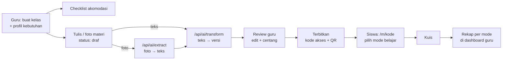

# Selaras

**Guru menyiapkan sekali, setiap siswa bisa mengikuti.**

Selaras adalah platform web pembelajaran inklusif. Guru cukup menulis atau memotret materi satu kali, lalu Selaras menyiapkannya dalam beberapa versi yang bisa dipilih siswa sesuai cara belajarnya: bahasa sederhana, bahasa daerah dengan glosarium, huruf besar dan kontras tinggi, ramah disleksia, atau dibacakan.

Dibuat untuk **Hackathon JOINTS UGM 2026** (JOINTSxINSPIRE, HIMAKOM FMIPA UGM), tema **Education**.

| | |
|---|---|
| 🌐 Aplikasi | _isi link Vercel_ |
| 🎬 Video demo | _isi link YouTube_ |
| 📊 Pitch deck | _isi link PDF_ |
| 🎨 Desain UI | _isi link Figma_ |

---

## Masalah

Guru honorer dan guru kelas gabungan sudah kehabisan waktu untuk modul ajar, soal, dan rapor. Mereka tidak sempat membuat versi materi yang berbeda untuk siswa low vision, tuli, disleksia, atau siswa yang bahasa ibunya bukan bahasa Indonesia. Akibatnya, siswa-siswa ini tertinggal di kelas yang sama.

## Solusi

Selaras membuat inklusi tidak menambah beban guru.

- **Sisi guru:** guru mengisi profil kebutuhan kelas, lalu mendapat checklist akomodasi dari panduan resmi. Setelah itu guru menulis materi sekali, dan AI menyiapkan versi-versinya untuk direview.
- **Sisi siswa:** siswa membuka materi lewat link atau QR tanpa login, lalu memilih "Cara belajarku".
- **Umpan balik:** kuis singkat mengikuti mode belajar siswa, dan guru melihat rekap pemakaian mode serta skor per mode.

Bedanya dengan alat yang sudah ada: Microsoft Immersive Reader hanya melayani sisi siswa, Ruang GTK hanya berisi referensi, dan ChatGPT/Gemini terlalu generik. Selaras menyatukan sisi guru dan sisi siswa dalam satu alur.

## Fitur

**Ruang Guru**
- Login guru (Supabase Auth)
- Buat kelas dan profil kebutuhan kelas. Profil ini agregat: hanya jumlah siswa per kebutuhan, tanpa nama siswa.
- Checklist akomodasi per kebutuhan, dikurasi dari Permendikbudristek No. 48 Tahun 2023 tentang akomodasi yang layak
- Input materi berupa teks atau foto halaman buku
- Pembuatan versi dengan AI: bahasa sederhana, Basa Jawa, Basa Sunda (masing-masing dengan glosarium), dan ringkasan
- Halaman review: semua versi tampil berdampingan, bisa diedit, dan wajib dicek sebelum terbit
- Terbitkan materi untuk mendapat kode akses 6 karakter, link, dan QR code
- Kuis pilihan ganda, dibuat manual atau di-generate AI dari materi
- Dashboard rekap: jumlah siswa per mode dan rata-rata skor per mode

**Ruang Siswa** (`/m/[kode]`, tanpa login, mobile-first)
- Pemilih mode "Cara belajarku": Teks biasa, Huruf besar & kontras tinggi, Ramah disleksia, Bahasa sederhana, Basa Jawa, Basa Sunda
- Dibacakan dengan Web Speech API (suara `id-ID`), lengkap dengan tombol jeda dan pengatur kecepatan
- Glosarium: ketuk kata sulit untuk melihat artinya
- Mode tersimpan di perangkat siswa dan dipakai lagi di materi berikutnya
- Kuis yang mengikuti mode belajar siswa

## Alur Kerja



## Tech Stack

| Bagian | Teknologi |
|---|---|
| Frontend & backend | Next.js (App Router), TypeScript, Tailwind CSS |
| Database, auth, storage | Supabase (PostgreSQL, Supabase Auth, Storage) |
| AI | Claude API (Anthropic), Gemini API (Google) |
| Text-to-speech | Web Speech API (bawaan browser) |
| Deployment | Vercel |

## Struktur Proyek

```
app/
├── login/                     # login guru
├── dashboard/                 # daftar kelas
├── kelas/
│   ├── baru/                  # buat kelas + profil kebutuhan
│   └── [id]/
│       ├── materi/baru/       # input materi (teks/foto)
│       └── rekap/             # dashboard rekap per mode
├── materi/[id]/
│   ├── review/                # review versi hasil AI
│   └── kuis/                  # pembuat kuis
├── m/[kode]/                  # halaman siswa
│   └── kuis/                  # kuis sisi siswa
└── api/ai/
    ├── extract/               # foto → teks
    ├── transform/             # teks → versi + glosarium
    └── quiz/                  # materi → soal kuis
lib/
├── prompts.ts                 # semua prompt AI di satu tempat
└── ai.ts                      # pemanggil AI + fallback
scripts/
└── seed.ts                    # data demo
```

## Skema Data

| Tabel | Kolom utama |
|---|---|
| `teacher` | id, nama, email, sekolah |
| `class` | id, teacher_id, nama, jenjang, mapel |
| `class_need` | class_id, kebutuhan (`low_vision`, `tuli`, `disleksia`, `bahasa_daerah`), jumlah |
| `material` | id, class_id, judul, teks_asli, foto_url, kode_akses, status (`draf`, `terbit`), created_at |
| `material_version` | id, material_id, jenis (`sederhana`, `jawa`, `sunda`, `ringkasan`), konten, glosarium (JSON), sudah_dicek |
| `quiz` | id, material_id, judul |
| `quiz_question` | id, quiz_id, pertanyaan, pilihan (JSON), jawaban_benar |
| `attempt` | id, quiz_id, mode, skor, durasi_detik, created_at |

Nilai `mode` di `attempt` adalah salah satu dari: `biasa`, `kontras`, `disleksia`, `dibacakan`, `sederhana`, `jawa`, `sunda`.

## Menjalankan di Lokal

**Prasyarat:** Node.js 18 atau lebih baru, akun Supabase, API key Anthropic dan Google AI Studio.

```bash
git clone https://github.com/TK-OS-FULL-CLAUDE/web-pembelajaran-selaras.git
cd web-pembelajaran-selaras
npm install
cp .env.example .env.local   # lalu isi nilainya
```

Isi `.env.local`:

```env
NEXT_PUBLIC_SUPABASE_URL=
NEXT_PUBLIC_SUPABASE_ANON_KEY=
SUPABASE_SERVICE_ROLE_KEY=
ANTHROPIC_API_KEY=
GEMINI_API_KEY=
CLAUDE_MODEL=
GEMINI_MODEL=
```

Siapkan database di Supabase:
1. Jalankan schema SQL di SQL Editor Supabase.
2. Buat storage bucket `materi-foto`.

Isi data demo, lalu jalankan aplikasi:

```bash
npx tsx scripts/seed.ts   # 1 guru, 2 kelas, 3 materi, 3 kuis, ±60 attempt
npm run dev               # buka http://localhost:3000
```

Script seed bisa dijalankan ulang kapan saja.

> **Jangan pernah commit `.env.local`.** Semua API key hanya dipakai di API route server, jadi tidak pernah sampai ke browser.

## Penggunaan AI (Transparansi)

Sesuai guidebook JOINTS 2026, penggunaan AI diperbolehkan asal transparan. Berikut rinciannya.

### AI sebagai fitur di dalam aplikasi

| Titik | Endpoint | Model utama | Cadangan | Output |
|---|---|---|---|---|
| Foto halaman buku → teks | `/api/ai/extract` | Gemini (vision) | Claude (vision) | teks materi |
| Materi → banyak versi | `/api/ai/transform` | Claude | Gemini | JSON versi + glosarium |
| Materi → soal kuis | `/api/ai/quiz` | Gemini | Claude | JSON soal |

**Pengaman:**
- Semua hasil AI berlabel **"Draf AI — wajib dicek guru"** dan tidak bisa terbit sebelum guru mereview lalu menekan Terbitkan.
- Prompt meminta AI tidak menambah fakta di luar materi guru.
- Terjemahan bahasa daerah ditandai **"perlu dicek penutur asli"**.
- Output AI divalidasi ke format JSON yang sudah ditentukan. Kalau gagal, sistem mencoba ulang sekali lalu beralih ke model cadangan.
- Fitur aksesibilitas tampilan (kontras, ramah disleksia, dibacakan) tidak bergantung pada AI, jadi tetap berjalan walaupun API AI bermasalah.

### AI sebagai alat bantu pengembangan

| Alat | Dipakai untuk |
|---|---|
| Claude (Anthropic) | Kajian ide dan tema, perencanaan build, penyusunan dokumen, bantuan coding |
| _tambahkan alat lain yang dipakai tim_ | _…_ |

Seluruh kode ditulis, direview, dan diuji oleh anggota tim.

## Tim

| Nama | Peran |
|---|---|
| Muhammad Faza Aqila | Fondasi & Ruang Guru: setup, database, login, kelas, editor materi |
| Michael Evan Putra Nugroho | Mesin AI & Review: ekstraksi foto, transformasi versi, review, terbit |
| Muhammad Sabri | Ruang Siswa: mode aksesibilitas, dibacakan, QR, data demo |
| Aufa Nurcahyo | UI Kit, Kuis & Rekap: komponen bersama, kuis, dashboard |

## Lisensi

Dibuat untuk keperluan Hackathon JOINTS UGM 2026. Library pihak ketiga dipakai sesuai lisensinya masing-masing.